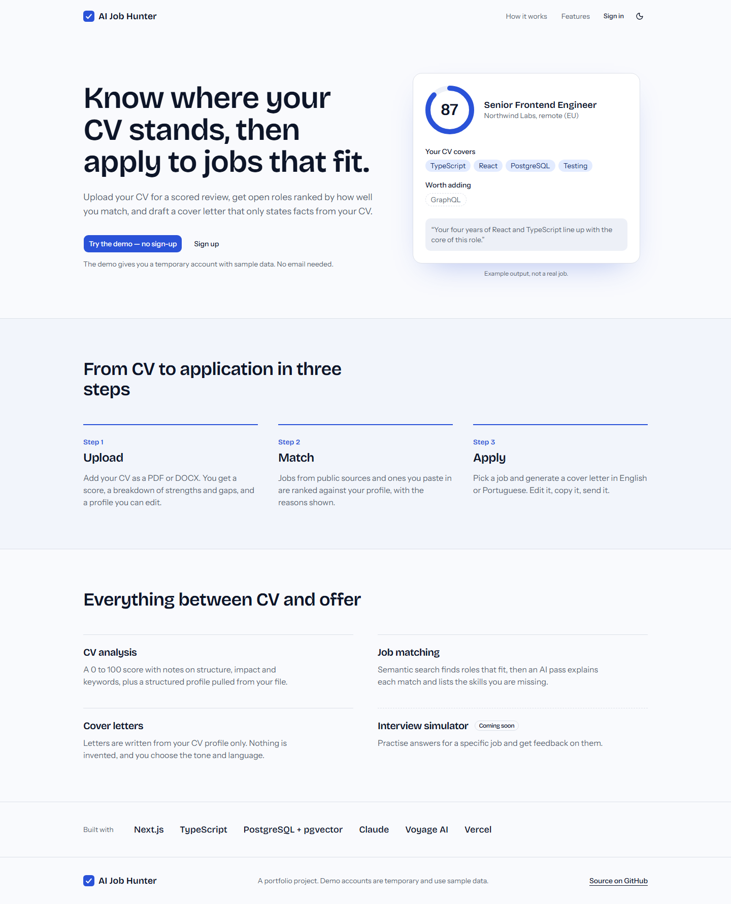
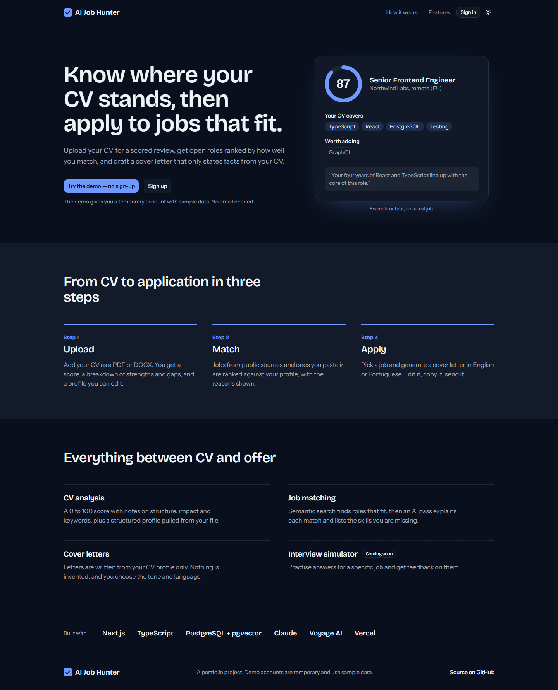
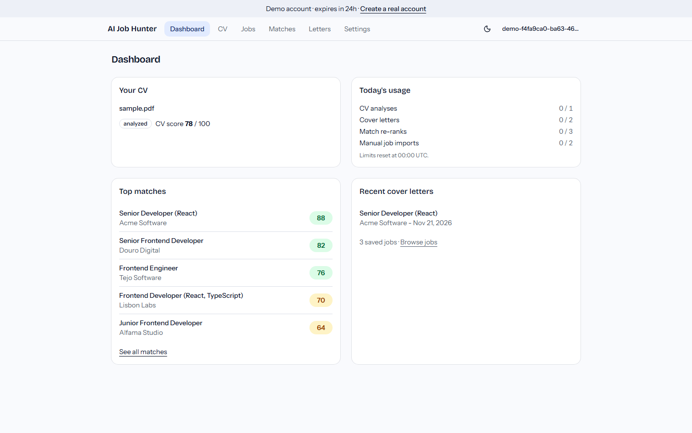
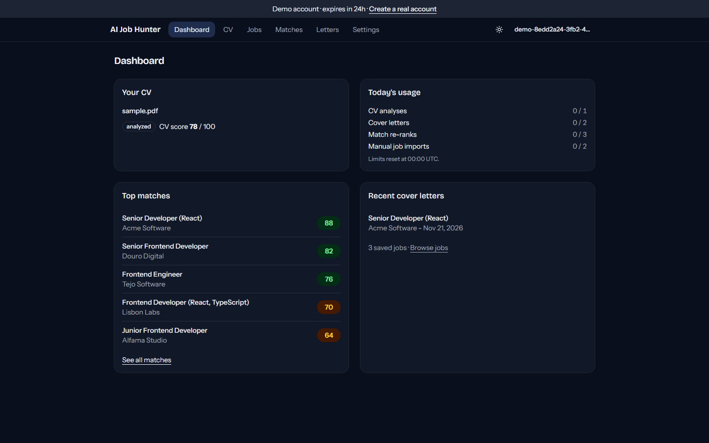
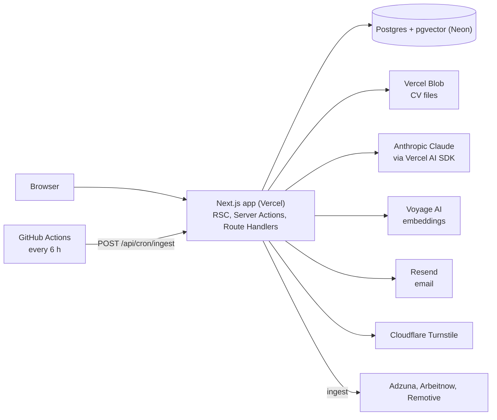

# AI Job Hunter

Upload a CV, get it analysed, find real jobs that fit it, and generate a cover letter that only uses facts from the CV.

[](https://github.com/rafael-a-g-n/ai-job-hunter/actions/workflows/ci.yml)

**Live demo:** TBD (one click, no sign-up; see [docs/deploy.md](docs/deploy.md) to host your own).

| Light | Dark |
|---|---|
|  |  |
|  |  |

## Features

- **CV analysis:** upload a PDF or DOCX (max 4 MB, which keeps the request under Vercel's 4.5 MB body limit). You get a 0 to 100 score with notes on structure, impact and keywords, and an editable structured profile. Scanned or empty files are rejected before any AI call.
- **Job matching:** semantic search over jobs ingested from Adzuna, Arbeitnow and Remotive, then an AI pass that explains each match and lists matched skills and gaps.
- **Manual jobs:** paste a posting as text; the AI normalizes it into a private job you can match against.
- **Cover letters:** streamed, editable, in English or Portuguese, with a choice of tone and length. The prompt restricts the letter to facts in your profile.
- **Accounts and demo:** email and password with verification, password reset, account and data deletion. A demo account is one click away, pre-filled with a CV, matches and a letter.
- **Interview simulator:** not built yet (shown as "coming soon").

UI copy is English only. AI output language is a per-request option.

## Architecture



## Stack

Next.js 16 (App Router, `cacheComponents`), React 19, TypeScript (strict), Tailwind CSS 4 and shadcn/ui, Prisma 7 on Postgres with pgvector, Better Auth, Vercel AI SDK with Anthropic Claude (`claude-haiku-5-5` for extraction and re-rank, `claude-sonnet-5-5` for letters), Voyage `voyage-3.5-lite` embeddings (1024 dimensions), Zod 4, Vitest and Playwright.

## How it works

1. **Ingest.** Every 6 hours a GitHub Actions workflow calls `POST /api/cron/ingest`. Each source is fetched with a 25 s deadline (Remotive at most once per 24 h). Jobs are deduplicated by a hash of title, company and location, embedded once, and expire 30 days after posting. A failing source is reported and skipped; the others still run. See [ADR 2](docs/adr/0002-ingest-not-live-search.md).
2. **Embeddings.** Each job and each analysed CV profile is embedded into a 1024-dimension vector stored in a pgvector column (HNSW index, cosine distance).
3. **Recall.** Matching takes the 50 jobs nearest to the CV vector, restricted to non-expired jobs that are public or owned by the user.
4. **Re-rank.** One AI call scores the top 10 recalled jobs that were never sent to the re-rank for this CV, returning a score, matched skills, gaps and an explanation. Results are cached per CV and job (a job the answer leaves out is recorded as attempted), so repeat visits cost nothing. If the daily limit is already reached, no unit is consumed and vector order is shown, with a note saying so. If the call fails, the consumed unit is refunded, vector order is shown, and that CV's re-rank pauses for 10 minutes.

## Run locally

Everything external is faked by default, so no keys are needed. Requires Node 24 and Docker.

```bash
docker compose up -d          # Postgres with pgvector on :5432 (and a test DB on :5433)
cp .env.example .env.local    # defaults use the fakes
npm install
npx prisma migrate deploy     # or `npx prisma migrate dev` if you are changing the schema
npm run db:seed               # sample jobs, so matching has something to find
npm run dev                   # http://localhost:3000
```

Click "Try the demo" on the landing page. Verification and reset emails are printed to the server console with the fake mailer.

Notes:

- `npm run build` loads the env validation, so it needs the variables set. Copy `.env.example` to `.env.local` first (CI sets placeholders).
- To use real services, change the provider variables in `.env.local` and add the matching keys; each is documented in `.env.example`. The seed's jobs have fake vectors, which stay in the database after switching to Voyage; re-run ingest or clear the embeddings.
- `npx tsx scripts/generate-demo-template.ts` regenerates the demo account's content (`src/server/demo/template-data.json`). Run it once with real keys to replace the committed mock output.

## Testing

```bash
npm run lint
npm run typecheck
npm test               # unit tests, no database
docker compose up -d db-test
npm run test:int       # integration tests against the real Postgres on :5433
npm run test:e2e       # Playwright; builds the app and starts it with all fakes
```

Integration tests apply migrations with `migrate deploy`, truncate tables between tests, and refuse to run against anything but the local test database. All tests run with fakes, so no keys or network are needed.

The e2e tests read verification and reset emails through `GET /api/test/mail`, a test-only route that returns what the console mailer "sent". It answers 404 unless both `E2E=1` (set only by the Playwright config) and `MAIL_PROVIDER=console`, so it does not exist in a real deployment.

## Design decisions

- [ADR 1: one Next.js app instead of a separate backend](docs/adr/0001-nextjs-monolith.md)
- [ADR 2: scheduled ingestion instead of live search](docs/adr/0002-ingest-not-live-search.md)
- [ADR 3: a fake for every external service](docs/adr/0003-fakes-for-external-services.md)
- [ADR 4: Better Auth instead of Auth.js](docs/adr/0004-better-auth.md)
- [ADR 5: behaviour rulings made during the build](docs/adr/0005-behaviour-rulings.md)

Domain vocabulary is in [GLOSSARY.md](GLOSSARY.md). The original design spec is in `docs/superpowers/specs/`.

## Limits and costs

Daily limits count per UTC day and are enforced by one atomic SQL statement, so parallel requests cannot exceed them.

| Action | Regular user | Demo user |
|---|---|---|
| CV analysis | 3 | 1 |
| Cover letter | 10 | 2 |
| Match re-rank | 10 | 3 |
| Manual job normalize | 10 | 2 |

- A global cap, `GLOBAL_DAILY_AI_BUDGET_USD` (default 5), stops all AI calls for the day once the recorded spend reaches it. Every call's token cost is stored in `AiCall`.
- Demo accounts expire after 24 h, with at most 3 per IP hash per day.
- Hosting fits free tiers (Vercel, Neon, Resend, Cloudflare, GitHub Actions). The only real cost is AI usage, bounded by the limits above.

## Security notes

- Every server function that reads or writes user data takes a `userId` and scopes its query by it. Another user's id gives 404, never data; integration tests cover cross-user access.
- Demo accounts are isolated users with their own copies of the template data.
- The demo button is protected by Cloudflare Turnstile; `TURNSTILE_BYPASS` exists for local and test use only.
- CV text and pasted postings are treated as untrusted in prompts, and our delimiter tags are stripped from them in letter prompts.
- External links are only rendered for `http:` and `https:` URLs.
- The ingest endpoint requires a bearer `CRON_SECRET`, compared in constant time.
- Secrets are read only through the validated `src/lib/env.ts`. Only `.env.example` is tracked.

## Deploying

Step-by-step guide for Neon, Vercel, Resend, Turnstile and the ingest workflow: [docs/deploy.md](docs/deploy.md).
